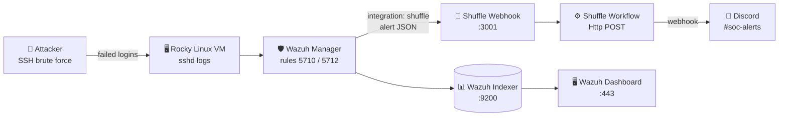

<div align="center">

# 🛡️ Wazuh × Shuffle SOAR Integration Lab

**Automated alerting pipeline: Wazuh detects an attack → Shuffle orchestrates → the SOC gets notified in Discord.**


</div>

---

## 📖 Table of Contents

1. [Overview](#-overview)
2. [Architecture](#-architecture)
3. [Lab Environment](#-lab-environment)
4. [Part 1: Prepare the VM](#-part-1--prepare-the-vm)
5. [Part 2: Install Wazuh](#-part-2--install-wazuh-all-in-one)
6. [Part 3: Install Docker](#-part-3--install-docker)
7. [Part 4: Install Shuffle](#-part-4--install-shuffle-soar)
8. [Part 5: Create the Shuffle Workflow](#-part-5--create-the-shuffle-workflow)
9. [Part 6: Connect Wazuh to Shuffle](#-part-6--connect-wazuh-to-shuffle)
10. [Part 7: Send Alerts to Discord](#-part-7--send-alerts-to-discord)
11. [Part 8: Brute-Force Attack Test](#-part-8--brute-force-attack-test)
12. [Troubleshooting](#-troubleshooting)
13. [Lessons Learned](#-lessons-learned)
14. [Next Labs](#-next-labs)

---

## 🔎 Overview

This lab connects **Wazuh** (an open-source SIEM/XDR) to **Shuffle** (an open-source SOAR platform). Every Wazuh alert above a chosen severity is pushed to a Shuffle **webhook**. A Shuffle **workflow** then formats the alert and sends it to a **Discord** channel, so analysts get real-time notifications without watching a dashboard.

| Component | Role in the lab |
|---|---|
| **Wazuh Manager** | Collects logs, matches detection rules, and generates alerts |
| **Wazuh Indexer / Dashboard** | Stores alerts and provides the web UI |
| **Shuffle** | Receives alerts through a webhook and runs automation workflows |
| **Discord** | Notification channel for the "SOC team" |

> [!NOTE]
> In this lab Wazuh and Shuffle run on the **same VM** to save resources. In production they would normally run on separate servers.

---

## 🧭 Architecture



### Port map (single VM)

| Service | Port | Notes |
|---|---|---|
| Wazuh Dashboard | `443/tcp` | `https://<VM_IP>` |
| Wazuh agent connection | `1514/tcp` | Agents send events here |
| Wazuh agent enrollment | `1515/tcp` | |
| Wazuh API | `55000/tcp` | Used later for active response |
| Wazuh Indexer | `9200/tcp` | ⚠️ Conflicts with Shuffle's OpenSearch |
| Shuffle UI (HTTP) | `3001/tcp` | Webhook endpoint used by Wazuh |
| Shuffle UI (HTTPS) | `3443/tcp` | `https://<VM_IP>:3443` |
| Shuffle OpenSearch | `9201/tcp` | **Remapped** from 9200 to avoid the conflict |

---

## 🧪 Lab Environment

| Item | Value |
|---|---|
| Hypervisor | VMware Workstation |
| Guest OS | Rocky Linux 9.5 (Blue Onyx) |
| CPU | 4 vCPU |
| RAM | **16 GB** (Wazuh + Shuffle together; never more than the host has) |
| Disk | **60 GB** recommended (30 GB fills up quickly) |
| Network | NAT |
| Example VM IP | `208.8.8.85` (replace with your own everywhere below) |

> [!IMPORTANT]
> Disk space matters. Wazuh's indexer, Shuffle's OpenSearch and Shuffle's app images all grow over time. When the disk passes **~90%**, OpenSearch switches to **read-only** and Shuffle can no longer save workflows.

---

## 🧰 Part 1: Prepare the VM

### 1.1 Find the VM's IP address
```bash
ip -br -4 a
```
Use the address on the real interface (for example `ens160`). Ignore `lo`, `docker0`, `br-*` and `veth*`.

### 1.2 Kernel and swap settings (required by OpenSearch)
```bash
sysctl -w vm.max_map_count=262144
echo "vm.max_map_count=262144" >> /etc/sysctl.conf
swapoff -a
```

### 1.3 Basic tools
```bash
dnf install -y git curl nano
```

---

## 🛡️ Part 2: Install Wazuh (all-in-one)

Install Wazuh **before** Shuffle. Shuffle's optional `tenzir-node` container also wants port `1514`, and Wazuh must own that port.

```bash
cd ~
curl -sO https://packages.wazuh.com/4.12/wazuh-install.sh
bash wazuh-install.sh -a
```

- Takes about **10–20 minutes**.
- A warning that Rocky Linux is not a "recommended system" is expected and harmless.
- At the end, the installer prints the dashboard credentials. **Save the password.**

```text
INFO: --- Summary ---
INFO: You can access the web interface https://<VM_IP>:443
    User: admin
    Password: <generated-password>
INFO: Installation finished.
```

Lost the password? Recover it with:
```bash
tar -O -xvf wazuh-install-files.tar wazuh-install-files/wazuh-passwords.txt
```

### 2.1 Verify
```bash
systemctl is-active wazuh-manager wazuh-indexer wazuh-dashboard
```
All three should print `active`. Open `https://<VM_IP>` and log in as `admin`.

<!-- 📸 Add screenshot: docs/images/wazuh-dashboard.png -->

---

## 🐳 Part 3: Install Docker

```bash
dnf install -y dnf-plugins-core
dnf config-manager --add-repo https://download.docker.com/linux/rhel/docker-ce.repo
dnf install -y docker-ce docker-ce-cli containerd.io docker-compose-plugin
systemctl enable --now docker
docker --version
```

### 3.1 Open the firewall (do this **before** starting Shuffle)
```bash
systemctl enable --now firewalld
firewall-cmd --permanent --add-port={443,1514,1515,55000,3001,3443}/tcp
firewall-cmd --reload
systemctl restart docker
```

> [!WARNING]
> Starting or restarting `firewalld` while Docker is running **wipes Docker's network rules**. The Shuffle UI still loads, but it can't reach its backend ("Failed to save the workflow. Is the network down?"). **Always run `systemctl restart docker` after touching firewalld.**

---

## ⚙️ Part 4: Install Shuffle SOAR

### 4.1 Clone Shuffle
```bash
cd ~
git clone https://github.com/Shuffle/Shuffle.git
cd Shuffle
```

### 4.2 Fix the port conflict with Wazuh
Shuffle's OpenSearch publishes port `9200`, which the Wazuh Indexer already uses. Remap **only the OpenSearch service** to `9201`:

```bash
sed -i 's/9200:9200/9201:9200/' docker-compose.yml
grep -n -E '920|FRONTEND_PORT' docker-compose.yml
```

Expected result:
```text
28:      - "${FRONTEND_PORT}:80"
29:      - "${FRONTEND_PORT_HTTPS}:443"
109:      - 9201:9200
```

> [!CAUTION]
> Don't edit the `frontend:` ports. Replacing `"${FRONTEND_PORT}:80"` removes port **3001**, which Wazuh needs to reach the webhook.

### 4.3 Start Shuffle
```bash
docker compose up -d
docker ps --format '{{.Names}}  {{.Status}}'
```
`shuffle-frontend`, `shuffle-backend`, `shuffle-opensearch`, `shuffle-orborus` and `shuffle-security` should all be `Up`.

> [!NOTE]
> Orborus may log errors about `tenzir-node` failing to bind `0.0.0.0:1514`. That's expected: Wazuh owns 1514. Tenzir only powers Shuffle's optional *Pipelines* feature and isn't needed here.

### 4.4 Open the UI
Go to `https://<VM_IP>:3443`, accept the self-signed certificate, and create the admin account.

<!-- 📸 Add screenshot: docs/images/shuffle-login.png -->

---

## 🔗 Part 5: Create the Shuffle Workflow

1. Go to **Workflows → Create Workflow**, name it `wazuh alerts`, and click **Create from scratch**.
2. In the left panel under **Triggers**, drag **Webhook** onto the canvas.
3. Click the webhook node:
   - Copy the **Webhook URI**.
   - Click **Start** so it listens.
4. Click **Save**.

The URI looks like:
```text
https://<VM_IP>:3443/api/v1/hooks/webhook_xxxxxxxx-xxxx-xxxx-xxxx-xxxxxxxxxxxx
```

> [!TIP]
> For Wazuh, change the start of the URL to **`http://<VM_IP>:3001`**. Wazuh's integration script can fail on Shuffle's self-signed HTTPS certificate, and plain HTTP on 3001 avoids that.

<!-- 📸 Add screenshot: docs/images/shuffle-webhook.png -->

---

## 🤝 Part 6: Connect Wazuh to Shuffle

Wazuh ships with a built-in `shuffle` integration. Point it at the webhook.

### 6.1 Back up and edit the manager config
```bash
cp /var/ossec/etc/ossec.conf /var/ossec/etc/ossec.conf.bak
nano /var/ossec/etc/ossec.conf
```

### 6.2 Add the integration block
Paste it on the empty line **right below the first `<ossec_config>`**:

```xml
<ossec_config>
  <integration>
    <name>shuffle</name>
    <hook_url>http://<VM_IP>:3001/api/v1/hooks/webhook_<YOUR-WEBHOOK-ID></hook_url>
    <level>5</level>
    <alert_format>json</alert_format>
  </integration>

  <global>
    ...
```

| Tag | Meaning |
|---|---|
| `name` | Must be `shuffle` (uses `/var/ossec/integrations/shuffle`) |
| `hook_url` | Your Shuffle webhook, on one line |
| `level` | Minimum rule level to forward. `3` = everything (noisy), `5` = good for demos, `7`+ = medium to critical only |
| `alert_format` | Must be `json` |

Save with **Ctrl+O → Enter → Ctrl+X**.

### 6.3 Restart and verify
```bash
systemctl restart wazuh-manager && systemctl is-active wazuh-manager
```

### 6.4 Confirm alerts arrive
In Shuffle, open the workflow and click **Debug**. Every Wazuh alert creates a new **run** with a webhook icon, and the webhook node's counter goes up.

<!-- 📸 Add screenshot: docs/images/shuffle-runs.png -->

### 6.5 What Wazuh sends
```json
{
  "severity": 2,
  "pretext": "WAZUH Alert",
  "title": "sshd: Attempt to login using a non-existent user",
  "text": "Invalid user fakeuser from 127.0.0.1 port 51234",
  "rule_id": "5710",
  "timestamp": "2026-10-23T14:32:45.076+0800",
  "id": "1792737165.1810307",
  "all_fields": {
    "rule":  { "level": 5, "id": "5710", "groups": ["sshd", "authentication_failed"] },
    "agent": { "id": "000", "name": "localhost.localdomain" },
    "data":  { "srcip": "127.0.0.1", "srcuser": "fakeuser" }
  }
}
```

Use any field in later actions with `$exec`:

| Variable | Example value |
|---|---|
| `$exec.title` | `sshd: Attempt to login using a non-existent user` |
| `$exec.all_fields.rule.level` | `5` |
| `$exec.all_fields.agent.name` | `localhost.localdomain` |
| `$exec.all_fields.data.srcip` | `127.0.0.1` |
| `$exec.all_fields.data.srcuser` | `fakeuser` |
| `$exec.timestamp` | `2026-10-23T14:32:45.076+0800` |

---

## 💬 Part 7: Send Alerts to Discord

### 7.1 Create a Discord webhook
Discord → your channel → ⚙️ **Edit Channel** → **Integrations** → **Webhooks** → **New Webhook** → name it `Wazuh-Shuffle` → **Copy Webhook URL**.

> [!CAUTION]
> Treat the Discord webhook URL like a password: anyone who has it can post to your channel. **Don't commit it to GitHub.** If it leaks, regenerate it.

### 7.2 Add an Http action
1. Drag **Http** from *Your Apps* onto the canvas.
2. Connect **Webhook 1 → Http 1**.
3. Click **Http 1** and then the **🏁 flag** icon to make it the **start node**.
4. Configure it:

| Field | Value |
|---|---|
| Action | `POST` |
| url | `https://discord.com/api/webhooks/<ID>/<TOKEN>` |
| headers | `Content-Type: application/json` |
| body | see below |

```json
{
  "content": "🚨 **Wazuh Alert** (level $exec.all_fields.rule.level)\n**Rule:** $exec.title\n**Agent:** $exec.all_fields.agent.name\n**Source IP:** $exec.all_fields.data.srcip\n**User:** $exec.all_fields.data.srcuser\n**Time:** $exec.timestamp"
}
```

5. Click **Save**, then reload the page (F5) and check that the header and body are still there.

### 7.3 Test with a previous alert
Click **▶ Run** in the bottom bar, choose **Select** on any previous alert, and check Discord.

<!-- 📸 Add screenshot: docs/images/discord-alert.png -->

---

## 🔥 Part 8: Brute-Force Attack Test

### 8.1 Simulate an SSH brute force
Run this on the VM itself (the source IP will be `127.0.0.1`):
```bash
for i in $(seq 1 12); do
  ssh -o BatchMode=yes -o StrictHostKeyChecking=no fakeuser@localhost
done
```

Or from another machine on the same network:
```bash
for i in $(seq 1 12); do
  ssh -o BatchMode=yes -o StrictHostKeyChecking=no fakeuser@<VM_IP>
done
```

### 8.2 Expected detections

| Rule ID | Level | Description |
|---|---|---|
| `5710` | 5 | sshd: Attempt to login using a non-existent user |
| `5712` | 10 | sshd: brute force trying to get access to the system (non-existent user) |
| `5760` | 5 | sshd: authentication failed |

### 8.3 Verify the full pipeline

| Step | Where | What you should see |
|---|---|---|
| 1 | Wazuh Dashboard → *Threat Hunting* | `sshd` authentication-failure alerts |
| 2 | Shuffle → workflow → *Debug* | New runs with green status |
| 3 | Shuffle → run → *Http 1* | `status: 204` (Discord accepted the message) |
| 4 | Discord channel | Alert message with **User: fakeuser** and **Source IP** filled in |

Example Discord message:
```text
🚨 Wazuh Alert (level 10)
Rule: sshd: brute force trying to get access to the system. Non existent user.
Agent: localhost.localdomain
Source IP: 127.0.0.1
User: fakeuser
Time: 2026-10-23T14:45:12.345+0800
```

<!-- 📸 Add screenshot: docs/images/bruteforce-discord.png -->

✅ **Result:** an attack is detected by Wazuh and automatically reported to the SOC channel through Shuffle, with no manual steps.

---

## 🩺 Troubleshooting

<details>
<summary><b>Shuffle shows "Waiting for the Shuffle database… connection refused"</b></summary>

OpenSearch is crashing. Check why:
```bash
docker logs shuffle-opensearch --tail 50
```
- `AccessDeniedException` → fix permissions and SELinux:
  ```bash
  chown -R 1000:1000 shuffle-database
  chcon -Rt svirt_sandbox_file_t shuffle-database
  docker restart shuffle-opensearch
  ```
- `max virtual memory areas vm.max_map_count` → `sysctl -w vm.max_map_count=262144`
</details>

<details>
<summary><b>Wazuh installer: "Port 1514 is being used by another process"</b></summary>

Shuffle's `tenzir-node` container holds 1514. Orborus recreates it, so stop Orborus during the install:
```bash
docker stop shuffle-orborus && docker rm -f tenzir-node
ss -tulnp | grep 1514            # should print nothing
bash wazuh-install.sh -a -o
docker start shuffle-orborus
```
</details>

<details>
<summary><b>Wazuh installer: "wazuh-manager could not be started"</b></summary>

Usually a port conflict (1514 or 9200) that appeared during the install. Check with `ss -tulnp | grep -E ':1514|:9200'`, free the port, and rerun with `-o`.
</details>

<details>
<summary><b>"Failed to save the workflow. Is the network down?"</b></summary>

1. **Disk full?** `df -h /`. Above ~90%, OpenSearch goes read-only. Free space or expand the disk:
   ```bash
   docker container prune -f && docker image prune -f && docker builder prune -f
   ```
   Then unlock Shuffle's indices:
   ```bash
   curl -sk -u 'admin:<SHUFFLE_OPENSEARCH_PASSWORD>' -X PUT "https://localhost:9201/_all/_settings" \
     -H 'Content-Type: application/json' -d '{"index.blocks.read_only_allow_delete": null}'
   ```
2. **Firewalld restarted?** → `systemctl restart docker && docker compose up -d`
</details>

<details>
<summary><b>Expanding the VM disk (Rocky Linux LVM)</b></summary>

1. Power off → VMware → *Hard Disk* → **Expand** to a size **larger** than the current one.
2. Boot, then:
   ```bash
   lsblk
   dnf install -y cloud-utils-growpart
   growpart /dev/nvme0n1 2
   pvresize /dev/nvme0n1p2
   lvextend -r -l +100%FREE /dev/rl/root
   df -h /
   ```
`NOCHANGE: partition could only be grown by -33` means the disk wasn't actually expanded in VMware.
</details>

<details>
<summary><b>Shuffle: "No startnode set"</b></summary>

The first action was deleted. Click the new first action and press the **🏁 flag** icon, then Save.
</details>

<details>
<summary><b>Discord returns 400: <code>Expected "Content-Type" header to be one of…</code></b></summary>

The header wasn't saved or sent. Re-enter `Content-Type: application/json` in **Headers**, save, reload the page, and confirm it's still there.
</details>

<details>
<summary><b>"Runtime Location: Stopped" in the Shuffle UI</b></summary>

This badge is often wrong on self-hosted Shuffle. Check whether runs actually finish. If they stay on *Executing*:
```bash
docker logs shuffle-orborus --tail 20
docker restart shuffle-orborus
```
</details>

<details>
<summary><b>No runs appear in Shuffle</b></summary>

```bash
grep -iE "integrat|shuffle" /var/ossec/logs/ossec.log | tail
curl -X POST http://<VM_IP>:3001/api/v1/hooks/webhook_<ID> \
  -H "Content-Type: application/json" -d '{"test":"hello"}'
```
If `curl` creates a run but Wazuh doesn't, check `<level>` and the `hook_url` in `ossec.conf`.
</details>

---

## 🧠 Lessons Learned

- 🔌 **Port planning first.** Wazuh and Shuffle both want `9200`, and Shuffle's Tenzir wants `1514`. Remap Shuffle's OpenSearch to `9201` and let Wazuh keep `1514`.
- 🧱 **Edit the right service.** In `docker-compose.yml`, change only the `shuffle-opensearch` port, never the frontend.
- 🔥 **Firewalld vs Docker.** After touching firewalld, restart Docker.
- 💾 **Disk = uptime.** A full disk makes OpenSearch read-only and silently breaks saving. Give the VM 60 GB+.
- 🧮 **RAM sanity.** Never assign the VM more RAM than the host has. 16 GB is enough for this lab.
- 🧪 **Test in layers.** Webhook received? → action ran? → HTTP status? → message delivered? Shuffle's *Debug* view shows each layer.

---

## 🚀 Next Labs

| # | Lab | New SOAR concept |
|---|---|---|
| 1 | File Integrity Monitoring → Discord | Using `syscheck` fields |
| 2 | Windows agent: failed logons, new admin user | Branching by `rule.id` |
| 3 | AbuseIPDB / VirusTotal IP reputation | Enrichment |
| 4 | EICAR test file + VirusTotal hash lookup | Malware triage |
| 5 | Auto-block attacker IP via Wazuh API | Automated response |
| 6 | "Block this IP?" approval before blocking | Human-in-the-loop |
| 7 | Daily alert summary via Schedule trigger | Scheduled automation |

---

## 📚 References

- [Wazuh documentation](https://documentation.wazuh.com/)
- [Wazuh integrations (`<integration>`)](https://documentation.wazuh.com/current/user-manual/manager/manual-integration.html)
- [Shuffle documentation](https://shuffler.io/docs)
- [Shuffle GitHub](https://github.com/Shuffle/Shuffle)
- [Discord webhooks](https://support.discord.com/hc/en-us/articles/228383668-Intro-to-Webhooks)

---

<div align="center">

Made as part of a SOC internship lab · ⭐ Star the repo if it helped!

</div>
