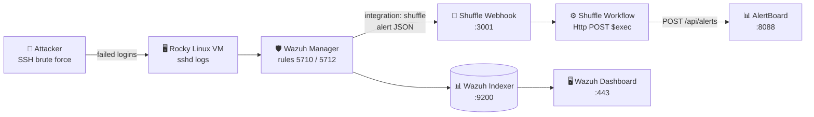

<div align="center">

# 🛡️ Wazuh × Shuffle SOAR Integration Lab

**Automated alerting pipeline: Wazuh detects an attack → Shuffle orchestrates → alerts land on a custom web dashboard.**


</div>

---

## 📖 Table of Contents

1. [Overview](#-overview)
2. [Architecture](#-architecture)
3. [Lab Environment](#-lab-environment)
4. [Part 1: Prepare the VM](#-part-1--prepare-the-vm)
5. [Part 2: Install Wazuh](#-part-2--install-wazuh-all-in-one)
6. [Part 3: Install Docker](#-part-3--install-docker)
7. [Part 4: Install Shuffle](#-part-4--install-shuffle-soar)
8. [Part 5: Create the Shuffle Workflow](#-part-5--create-the-shuffle-workflow)
9. [Part 6: Connect Wazuh to Shuffle](#-part-6--connect-wazuh-to-shuffle)
10. [Part 7: Build the AlertBoard Dashboard](#-part-7--build-the-alertboard-dashboard)
11. [Part 8: Brute-Force Attack Test](#-part-8--brute-force-attack-test)
12. [Troubleshooting](#-troubleshooting)
13. [Lessons Learned](#-lessons-learned)
14. [Next Labs](#-next-labs)

---

## 🔎 Overview

This lab connects **Wazuh** (an open-source SIEM/XDR) to **Shuffle** (an open-source SOAR platform). Every Wazuh alert above a chosen severity is pushed to a Shuffle **webhook**. A Shuffle **workflow** then forwards the alert to **AlertBoard**, a small self-hosted web dashboard built for this lab, so analysts see alerts on a live page instead of watching the raw Wazuh console.

Instead of a third-party notifier like Discord or Slack, the alerts are sent to a **custom Python dashboard** running on the same VM. It needs no external accounts, works entirely on the lab network, and demonstrates exactly how a SOAR tool can hand data to any HTTP endpoint you control.

| Component | Role in the lab |
|---|---|
| **Wazuh Manager** | Collects logs, matches detection rules, and generates alerts |
| **Wazuh Indexer / Dashboard** | Stores alerts and provides the web UI |
| **Shuffle** | Receives alerts through a webhook and runs automation workflows |
| **AlertBoard** | Custom Python web dashboard that stores and displays the alerts |

> [!NOTE]
> In this lab Wazuh, Shuffle and AlertBoard all run on the **same VM** to save resources. In production they would normally run on separate servers.

---

## 🧭 Architecture



### Port map (single VM)

| Service | Port | Notes |
|---|---|---|
| Wazuh Dashboard | `443/tcp` | `https://<VM_IP>` |
| Wazuh agent connection | `1514/tcp` | Agents send events here |
| Wazuh agent enrollment | `1515/tcp` | |
| Wazuh API | `55000/tcp` | Used later for active response |
| Wazuh Indexer | `9200/tcp` | ⚠️ Conflicts with Shuffle's OpenSearch |
| Shuffle UI (HTTP) | `3001/tcp` | Webhook endpoint used by Wazuh |
| Shuffle UI (HTTPS) | `3443/tcp` | `https://<VM_IP>:3443` |
| Shuffle OpenSearch | `9201/tcp` | **Remapped** from 9200 to avoid the conflict |
| **AlertBoard** | `8088/tcp` | `http://<VM_IP>:8088` — custom dashboard |

---

## 🧪 Lab Environment

| Item | Value |
|---|---|
| Hypervisor | VMware Workstation |
| Guest OS | Rocky Linux 9.5 (Blue Onyx) |
| CPU | 4 vCPU |
| RAM | **16 GB** (Wazuh + Shuffle together; never more than the host has) |
| Disk | **60 GB** recommended (30 GB fills up quickly) |
| Network | NAT |
| Example VM IP | `<VM_IP>` (replace with your own everywhere below) |

> [!IMPORTANT]
> Disk space matters. Wazuh's indexer, Shuffle's OpenSearch and Shuffle's app images all grow over time. When the disk passes **~90%**, OpenSearch switches to **read-only**, Shuffle can no longer save workflows, and Wazuh can stop recording new alerts. This lab started on a 30 GB disk and had to be expanded to 60 GB — see [Troubleshooting → Expanding the VM disk](#-troubleshooting).

---

## 🧰 Part 1: Prepare the VM

### 1.1 Find the VM's IP address
```bash
ip -br -4 a
```
Use the address on the real interface (for example `ens160`). Ignore `lo`, `docker0`, `br-*` and `veth*`.

### 1.2 Kernel and swap settings (required by OpenSearch)
```bash
sysctl -w vm.max_map_count=262144
echo "vm.max_map_count=262144" >> /etc/sysctl.conf
swapoff -a
```

### 1.3 Basic tools
```bash
dnf install -y git curl nano
```

---

## 🛡️ Part 2: Install Wazuh (all-in-one)

Install Wazuh **before** Shuffle. Shuffle's optional `tenzir-node` container also wants port `1514`, and Wazuh must own that port.

```bash
cd ~
curl -sO https://packages.wazuh.com/4.12/wazuh-install.sh
bash wazuh-install.sh -a
```

- Takes about **10–20 minutes**.
- A warning that Rocky Linux is not a "recommended system" is expected and harmless.
- At the end, the installer prints the dashboard credentials. **Save the password.**

```text
INFO: --- Summary ---
INFO: You can access the web interface https://<VM_IP>:443
    User: admin
    Password: <generated-password>
INFO: Installation finished.
```

Lost the password? Recover it with:
```bash
tar -O -xvf wazuh-install-files.tar wazuh-install-files/wazuh-passwords.txt
```

### 2.1 Verify
```bash
systemctl is-active wazuh-manager wazuh-indexer wazuh-dashboard
```
All three should print `active`. Open `https://<VM_IP>` and log in as `admin`.

> [!TIP]
> Dashboard times out but the services are `active`? firewalld is probably blocking port 443. See [Troubleshooting](#-troubleshooting) → *Wazuh dashboard times out, but Shuffle (3443) works*.

---

## 🐳 Part 3: Install Docker

```bash
dnf install -y dnf-plugins-core
dnf config-manager --add-repo https://download.docker.com/linux/rhel/docker-ce.repo
dnf install -y docker-ce docker-ce-cli containerd.io docker-compose-plugin
systemctl enable --now docker
docker --version
```

### 3.1 Open the firewall (do this **before** starting Shuffle)
```bash
systemctl enable --now firewalld
firewall-cmd --permanent --add-port={443,1514,1515,55000,3001,3443,8088}/tcp
firewall-cmd --reload
systemctl restart docker
firewall-cmd --list-ports
```
Port `8088` is opened here for the AlertBoard dashboard built in Part 7.

> [!WARNING]
> Starting or restarting `firewalld` while Docker is running **wipes Docker's network rules**. The Shuffle UI still loads, but it can't reach its backend ("Failed to save the workflow. Is the network down?"). **Always run `systemctl restart docker` after touching firewalld.**

---

## ⚙️ Part 4: Install Shuffle SOAR

### 4.1 Clone Shuffle
```bash
cd ~
git clone https://github.com/Shuffle/Shuffle.git
cd Shuffle
```

### 4.2 Fix the port conflict with Wazuh
Shuffle's OpenSearch publishes port `9200`, which the Wazuh Indexer already uses. Remap **only the OpenSearch service** to `9201`:

```bash
sed -i 's/9200:9200/9201:9200/' docker-compose.yml
grep -n -E '920|FRONTEND_PORT' docker-compose.yml
```

Expected result:
```text
28:      - "${FRONTEND_PORT}:80"
29:      - "${FRONTEND_PORT_HTTPS}:443"
109:      - 9201:9200
```

> [!CAUTION]
> Don't edit the `frontend:` ports. Replacing `"${FRONTEND_PORT}:80"` removes port **3001**, which Wazuh needs to reach the webhook.

### 4.3 Start Shuffle
```bash
docker compose up -d
docker ps --format '{{.Names}}  {{.Status}}'
```
`shuffle-frontend`, `shuffle-backend`, `shuffle-opensearch`, `shuffle-orborus` and `shuffle-security` should all be `Up`.

> [!NOTE]
> Orborus may log errors about `tenzir-node` failing to bind `0.0.0.0:1514`. That's expected: Wazuh owns 1514. Tenzir only powers Shuffle's optional *Pipelines* feature and isn't needed here. The Admin → Locations page may show Orborus as **Stopped** — the basic Webhook → Http workflow still runs without it.

### 4.4 Open the UI
Go to `https://<VM_IP>:3443`, accept the self-signed certificate, and create the admin account.

---

## 🔗 Part 5: Create the Shuffle Workflow

1. Go to **Workflows → Create Workflow**, name it `wazuh alerts`, and click **Create from scratch**.
2. In the left panel under **Triggers**, drag **Webhook** onto the canvas.
3. Click the webhook node:
   - Copy the **Webhook URI**.
   - Click **Start** so it listens.
4. Click **Save**.

The URI looks like:
```text
https://<VM_IP>:3443/api/v1/hooks/webhook_xxxxxxxx-xxxx-xxxx-xxxx-xxxxxxxxxxxx
```

> [!TIP]
> For Wazuh, change the start of the URL to **`http://<VM_IP>:3001`**. Wazuh's integration script can fail on Shuffle's self-signed HTTPS certificate, and plain HTTP on 3001 avoids that.

---

## 🤝 Part 6: Connect Wazuh to Shuffle

Wazuh ships with a built-in `shuffle` integration. Point it at the webhook.

### 6.1 Back up and edit the manager config
```bash
cp /var/ossec/etc/ossec.conf /var/ossec/etc/ossec.conf.bak
nano /var/ossec/etc/ossec.conf
```

### 6.2 Add the integration block
Paste it on the empty line **right below the first `<ossec_config>`**:

```xml
<ossec_config>
  <integration>
    <name>shuffle</name>
    <hook_url>http://<VM_IP>:3001/api/v1/hooks/webhook_<YOUR-WEBHOOK-ID></hook_url>
    <level>5</level>
    <alert_format>json</alert_format>
  </integration>

  <global>
    ...
```

| Tag | Meaning |
|---|---|
| `name` | Must be `shuffle` (uses `/var/ossec/integrations/shuffle`) |
| `hook_url` | Your Shuffle webhook, on one line |
| `level` | Minimum rule level to forward. `3` = everything (noisy), `5` = good for demos, `7`+ = medium to critical only |
| `alert_format` | Must be `json` |

Save with **Ctrl+O → Enter → Ctrl+X**.

> [!CAUTION]
> Three edits break the manager and stop it restarting: leaving the placeholder `<VM_IP>` / `<YOUR-WEBHOOK-ID>` angle brackets in, breaking the top comment's closing `-->`, or pasting a **second** `<global>` block. Keep only one `<global>` section, and replace every placeholder with real values.

### 6.3 Restart and verify
```bash
systemctl restart wazuh-manager && systemctl is-active wazuh-manager
```

### 6.4 Confirm alerts arrive
In Shuffle, open the workflow and click **Debug**. Every Wazuh alert creates a new **run** with a webhook icon, and the webhook node's counter goes up.

### 6.5 What Wazuh sends
```json
{
  "severity": 2,
  "pretext": "WAZUH Alert",
  "title": "sshd: Attempt to login using a non-existent user",
  "text": "Invalid user fakeuser from 127.0.0.1 port 51234",
  "rule_id": "5710",
  "timestamp": "2026-10-26T14:32:45.076+0800",
  "id": "1792737165.1810307",
  "all_fields": {
    "rule":  { "level": 5, "id": "5710", "groups": ["sshd", "authentication_failed"] },
    "agent": { "id": "000", "name": "localhost.localdomain" },
    "data":  { "srcip": "127.0.0.1", "srcuser": "fakeuser" }
  }
}
```

Use any field in later actions with `$exec`:

| Variable | Example value |
|---|---|
| `$exec.title` | `sshd: Attempt to login using a non-existent user` |
| `$exec.all_fields.rule.level` | `5` |
| `$exec.all_fields.agent.name` | `localhost.localdomain` |
| `$exec.all_fields.data.srcip` | `127.0.0.1` |
| `$exec.all_fields.data.srcuser` | `fakeuser` |
| `$exec.timestamp` | `2026-10-26T14:32:45.076+0800` |

---

## 📊 Part 7: Build the AlertBoard Dashboard

AlertBoard is a small web dashboard that receives alerts from Shuffle and displays them live. It is a single Python file ([`alertboard.py`](alertboard.py)) that uses only the standard library — nothing to `pip install` — and stores alerts in a local SQLite database.

**Features**
- Severity count cards (Critical / High / Medium / Low) using Wazuh's level ranges.
- A table of time, level, rule ID, description, agent, source IP, user and MITRE technique.
- Live search and a "Clear all" button; the page auto-refreshes every 5 seconds.
- Click a row to see the full raw alert JSON.

### 7.1 Deploy the script
Copy [`alertboard.py`](alertboard.py) to the VM, then:
```bash
mkdir -p /opt/alertboard && mv alertboard.py /opt/alertboard/
```

### 7.2 Run it as a service
```bash
cat > /etc/systemd/system/alertboard.service <<'EOF'
[Unit]
Description=AlertBoard
After=network.target

[Service]
ExecStart=/usr/bin/python3 /opt/alertboard/alertboard.py
Restart=always

[Install]
WantedBy=multi-user.target
EOF

systemctl daemon-reload
systemctl enable --now alertboard
```

### 7.3 Confirm it's up
```bash
curl -s localhost:8088/health        # -> {"ok": true}
```
Open **`http://<VM_IP>:8088`** in a browser (plain HTTP, not HTTPS). Port `8088` was opened in [Part 3](#-part-3--install-docker).

### 7.4 Point the Shuffle workflow at AlertBoard
1. Drag **Http** from *Your Apps* onto the canvas.
2. Connect **Webhook 1 → Http 1**.
3. Click **Http 1**, then the **🏁 flag** icon to make it the **start node**.
4. Configure it:

| Field | Value |
|---|---|
| Action | `POST` |
| url | `http://<VM_IP>:8088/api/alerts` |
| headers | `Content-Type: application/json` |
| body | `$exec` |

> [!TIP]
> The body is literally `$exec` — the whole Wazuh alert. AlertBoard extracts the fields itself (level, rule, source IP, user, MITRE), so there's no message template to maintain.

5. Click **Save**, then reload the page (F5) and confirm the url, headers and body are still there.

### 7.5 Test the endpoint directly
```bash
curl -X POST http://<VM_IP>:8088/api/alerts \
  -H "Content-Type: application/json" \
  -d '{"all_fields":{"rule":{"level":10,"id":"5712","description":"test"},"agent":{"name":"demo"},"data":{"srcip":"203.0.113.9","srcuser":"admin"}}}'
```
A new row should appear on the dashboard within ~5 seconds.

---

## 🔥 Part 8: Brute-Force Attack Test

### 8.1 Simulate an SSH brute force
Run this on the VM itself (the source IP will be `127.0.0.1` / `::1`):
```bash
for i in $(seq 20); do
  ssh -o BatchMode=yes -o StrictHostKeyChecking=no user$i@localhost exit
done
```

Or from another machine on the same network (the source IP will be that machine's):
```bash
for u in root admin oracle test guest ubuntu postgres ftpuser support jenkins; do
  ssh -o BatchMode=yes -o ConnectTimeout=5 "$u@<VM_IP>" exit
done
```

### 8.2 Expected detections

| Rule ID | Level | Description |
|---|---|---|
| `5710` | 5 | sshd: Attempt to login using a non-existent user |
| `5712` | 10 | sshd: brute force trying to get access to the system (non-existent user) |
| `5760` | 5 | sshd: authentication failed |

> [!NOTE]
> Wazuh's `shuffle` integration **skips** rule `5710` (single failed logins) by design — see `/var/ossec/integrations/shuffle.py`. The alert that reaches AlertBoard is the **5712 brute-force** composite, which fires after ~8 failed logins from the same IP within ~2 minutes. Wazuh also suppresses repeat 5712 alerts from the same IP for a short window, so re-running the test immediately may add nothing — wait a few minutes, or attack from a different source IP.

### 8.3 Verify the full pipeline

| Step | Where | What you should see |
|---|---|---|
| 1 | Wazuh Dashboard → *Threat Hunting* (set time range!) | `rule.id:5712` alerts |
| 2 | Shuffle → workflow → *Debug* | New runs with green status |
| 3 | Shuffle → run → *Http 1* | `status: 201` (AlertBoard accepted the alert) |
| 4 | AlertBoard (`http://<VM_IP>:8088`) | A level-10 row with **Rule 5712**, **Source IP** and **User** filled in |

✅ **Result:** an attack is detected by Wazuh and automatically reported to a self-hosted dashboard through Shuffle, with no manual steps and no third-party service.

> [!TIP]
> Source IP and User only appear for alerts that involve a network login (SSH rules). File-integrity (rule `750`/`594`) and system alerts (`531`/`1007`) have no IP or user, so those columns show `-` — that's expected, not missing data.

---

## 🩺 Troubleshooting

<details>
<summary><b>Shuffle shows "Waiting for the Shuffle database… connection refused"</b></summary>

OpenSearch is crashing. Check why:
```bash
docker logs shuffle-opensearch --tail 50
```
- `AccessDeniedException` → fix permissions and SELinux:
  ```bash
  chown -R 1000:1000 shuffle-database
  chcon -Rt svirt_sandbox_file_t shuffle-database
  docker restart shuffle-opensearch
  ```
- `max virtual memory areas vm.max_map_count` → `sysctl -w vm.max_map_count=262144`
</details>

<details>
<summary><b>Wazuh installer: "Port 1514 is being used by another process"</b></summary>

Shuffle's `tenzir-node` container holds 1514. Orborus recreates it, so stop Orborus during the install:
```bash
docker stop shuffle-orborus && docker rm -f tenzir-node
ss -tulnp | grep 1514            # should print nothing
bash wazuh-install.sh -a -o
docker start shuffle-orborus
```
</details>

<details>
<summary><b>wazuh-manager won't restart after editing ossec.conf</b></summary>

Almost always broken XML in `/var/ossec/etc/ossec.conf`:
- Placeholder angle brackets left in (`<VM_IP>`, `<YOUR-WEBHOOK-ID>`).
- The top comment's closing `-->` got merged into `<ossec_config>`.
- A **second** `<global>` block was pasted in (keep only one).

Check the first lines and the integration block:
```bash
head -n 12 /var/ossec/etc/ossec.conf
grep -n -A6 "<integration>" /var/ossec/etc/ossec.conf
```
Stuck? Restore the backup and redo the edit:
```bash
cp /var/ossec/etc/ossec.conf.bak /var/ossec/etc/ossec.conf
```
</details>

<details>
<summary><b>Wazuh dashboard times out, but Shuffle (3443) works</b></summary>

Docker publishes its ports through its own firewall rules, which bypass firewalld. Wazuh runs directly on the host, so firewalld blocks it unless the ports are open. firewalld also starts again automatically after a reboot. Check:
```bash
systemctl is-active wazuh-manager wazuh-indexer wazuh-dashboard   # all active
ss -tlnp | grep -E ':443 |:55000'                                  # Wazuh is listening
firewall-cmd --list-ports                                          # empty = blocked
```
Fix (restart Docker afterwards, because the reload can wipe its rules):
```bash
firewall-cmd --permanent --add-port={443,1514,1515,55000,3001,3443,8088}/tcp
firewall-cmd --reload
systemctl restart docker && cd ~/Shuffle && docker compose up -d
```
</details>

<details>
<summary><b>Wazuh dashboard: service is "failed" after a reboot</b></summary>

The dashboard often starts before the indexer is ready. Restart the indexer first, then the dashboard:
```bash
systemctl is-active wazuh-indexer wazuh-manager wazuh-dashboard
systemctl restart wazuh-indexer && sleep 30 && systemctl restart wazuh-manager wazuh-dashboard
```
</details>

<details>
<summary><b>Wazuh dashboard shows "No results" even though alerts exist</b></summary>

It's the **time filter**, not missing data. The range at the top right may be set to a single past instant. Set it to **Last 24 hours** and refresh. Almost every "logs gone" in the dashboard is this.
</details>

<details>
<summary><b>Disk full: AlertBoard stops updating / "File system full" flood</b></summary>

When `/` hits ~100%, Wazuh can't write new alerts, so nothing reaches AlertBoard, and it spams rule `1007` "File system full". Free space, then expand the disk:
```bash
df -h /
docker system prune -af --volumes
```
If OpenSearch went read-only, unlock Shuffle's indices:
```bash
curl -sk -u 'admin:<SHUFFLE_OPENSEARCH_PASSWORD>' -X PUT "https://localhost:9201/_all/_settings" \
  -H 'Content-Type: application/json' -d '{"index.blocks.read_only_allow_delete": null}'
```
</details>

<details>
<summary><b>Expanding the VM disk (Rocky Linux LVM)</b></summary>

This lab's 30 GB disk filled up and had to be grown to 60 GB.
1. Power off → VMware → *Hard Disk* → **Expand** to a larger size. (If **Expand** is greyed out, delete snapshots first.)
2. Boot, then:
   ```bash
   lsblk
   dnf install -y cloud-utils-growpart
   growpart /dev/nvme0n1 2
   pvresize /dev/nvme0n1p2
   lvextend -r -l +100%FREE /dev/rl/root
   df -h /
   ```
`NOCHANGE: partition could only be grown by -33` means the disk wasn't actually expanded in VMware.
</details>

<details>
<summary><b>Shuffle: "No startnode set"</b></summary>

The first action isn't the start node. Click the **Http** action and press the **🏁 flag** icon, then Save.
</details>

<details>
<summary><b>Shuffle webhook returns 400 / rejects the alert</b></summary>

The webhook isn't started. Click the **Webhook** node → **Start** (it should change to **Stop**) → **Save**. Then re-test:
```bash
curl -X POST http://<VM_IP>:3001/api/v1/hooks/webhook_<ID> \
  -H "Content-Type: application/json" -d '{"test":"hello"}'
```
A working webhook replies `{"success": true, ...}`.
</details>

<details>
<summary><b>"Runtime Location: Stopped" in the Shuffle UI</b></summary>

This badge reflects Orborus, which can't fully start because Wazuh owns port 1514. The basic Webhook → Http workflow still runs without it — confirm by checking that test alerts reach AlertBoard. Ignore the badge, or `docker start shuffle-orborus` if you want it green.
</details>

<details>
<summary><b>No alerts appear on AlertBoard</b></summary>

```bash
systemctl is-active alertboard                         # the dashboard service
curl -s localhost:8088/health                          # {"ok": true}
grep -iE "integrat|shuffle" /var/ossec/logs/ossec.log | tail
curl -X POST http://<VM_IP>:3001/api/v1/hooks/webhook_<ID> \
  -H "Content-Type: application/json" -d '{"test":"hello"}'
```
If `curl` to the webhook creates a Shuffle run but Wazuh alerts don't, check `<level>` and `hook_url` in `ossec.conf`.
</details>

---

## 🧠 Lessons Learned

- 🔌 **Port planning first.** Wazuh and Shuffle both want `9200`, and Shuffle's Tenzir wants `1514`. Remap Shuffle's OpenSearch to `9201` and let Wazuh keep `1514`.
- 🧱 **Edit the right service.** In `docker-compose.yml`, change only the `shuffle-opensearch` port, never the frontend.
- 🔥 **Firewalld vs Docker.** Docker's ports bypass firewalld; Wazuh's (and AlertBoard's) don't. Open them with `--permanent`, and restart Docker after touching firewalld.
- 💾 **Disk = uptime.** A full disk makes OpenSearch read-only, stops Wazuh recording alerts, and floods rule `1007`. Give the VM 60 GB+ and watch `df -h /`.
- 🧮 **RAM sanity.** Never assign the VM more RAM than the host has. 16 GB is enough for this lab.
- 🧪 **Test in layers.** Webhook received? → action ran? → HTTP status 201? → row on AlertBoard? Shuffle's *Debug* view shows each layer.
- 🧯 **Know your rules.** Single failed logins (5710) are intentionally skipped; the brute-force composite (5712) is what fires, and only after a burst. Repeats from one IP are rate-limited.
- 🛠️ **SOAR is glue.** Shuffle forwards the alert to whatever HTTP endpoint you own — Discord, Slack, or a dashboard you wrote yourself. AlertBoard proves you don't need a third-party service.

---

## 🚀 Next Labs

| # | Lab | New SOAR concept |
|---|---|---|
| 1 | Add the Windows agent: failed logons, new admin user | Branching by `rule.id` |
| 2 | AbuseIPDB / VirusTotal IP reputation enrichment | Enrichment before display |
| 3 | EICAR test file + VirusTotal hash lookup | Malware triage |
| 4 | Auto-block attacker IP via Wazuh API (active response) | Automated response |
| 5 | "Block this IP?" approval before blocking | Human-in-the-loop |
| 6 | Severity routing (critical → page, low → dashboard only) | Conditional actions |
| 7 | Daily alert summary via Schedule trigger | Scheduled automation |

---

## 📚 References

- [Wazuh documentation](https://documentation.wazuh.com/)
- [Wazuh integrations (`<integration>`)](https://documentation.wazuh.com/current/user-manual/manager/manual-integration.html)
- [Shuffle documentation](https://shuffler.io/docs)
- [Shuffle GitHub](https://github.com/Shuffle/Shuffle)
- [Python http.server](https://docs.python.org/3/library/http.server.html)

---

<div align="center">

Made as part of a SOC internship lab · ⭐ Star the repo if it helped!

</div>
